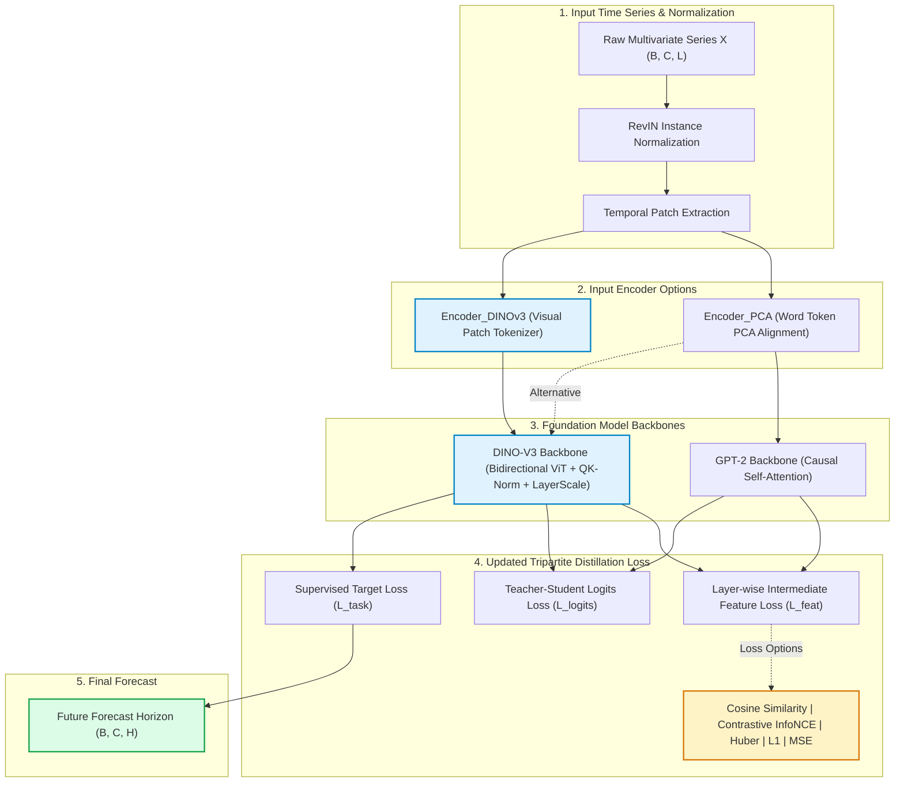

# Taming Pre-trained Foundation Models for Generalized Time Series Forecasting through Cross-modal Knowledge Distillation (CALF + DINO-V3)

[](https://arxiv.org/abs/2403.07300)
[](https://github.com/NguyenVDat104/CALF_GPT4TS)
[](https://calf-gpt4ts.onrender.com/)

---

## 🌟 Major Architectural Updates: DINO-V3 & Advanced Distillation Loss Functions

This enhanced release of **CALF (Cross-modal Alignment & Fine-tuning)** upgrades the framework from text-only language models (GPT-2) to multimodal vision foundation models (**Meta's DINO-V3 Vision Transformer**) and introduces a modernized, multi-objective distillation loss suite.



---

## 1. DINO-V3 Vision Backbone & Encoder Integration

### 1.1 Motivation: Why Vision Transformers (DINO-V3) for Time Series?
While the original CALF framework utilizes GPT-2, autoregressive language models suffer from two structural constraints when applied to physical time series:
1. **Unidirectional Causal Masking:** GPT-2 forces causal attention (each token only attends to past tokens), preventing historical patches from mutually conditioning each other bidirectionally.
2. **Discrete Text Token Mismatch:** Text vocabularies are discrete and categorical. In contrast, **DINO-V3 (Vision Foundation Model)** is trained via self-supervised discriminative learning on dense, continuous pixel fields, producing continuous latent spaces that naturally match normalized numerical signals.

### 1.2 Core DINO-V3 Modules (`models/dinov3_arch.py`)
* **`DINOv3Backbone`**:
  * Seamlessly connects to pretrained Hugging Face checkpoints (e.g. `facebook/dinov3-*` / `facebook/dinov2-*`) with an automatic offline fallback to a pure PyTorch ViT.
  * Incorporates **QK-Normalization** (stabilizing attention entropy in deep networks) and **LayerScale** ($\text{diag}(\lambda) \cdot x$ initialized to $10^{-5}$) for stable fine-tuning.
  * Extracts multi-layer intermediate hidden representations across layers $l \in \{1, \dots, L\}$ to drive intermediate knowledge distillation.
* **`Encoder_DINOv3`**:
  * Projects 1D temporal channel patches into high-dimensional visual token patches using 1D/2D convolution kernels.
  * Performs cross-attention between temporal visual tokens and anchor word embeddings, establishing a cross-modal bridge before entering the transformer backbone.
* **Configurations**:
  * `--backbone dinov3`: Replaces GPT-2 with DINO-V3 ViT blocks.
  * `--encoder dinov3`: Replaces PCA projection with DINO-V3 visual patch tokenizer.
  * `--backbone dinov3 --encoder dinov3`: End-to-end vision-transformer time-series forecasting.

---

## 2. Updated Loss Function Suite (`utils/distillationLoss.py`)

CALF trains the forecasting model via a **Tripartite Multi-Objective Distillation Objective**:

$$\mathcal{L}_{\text{total}} = w_{\text{task}} \cdot \mathcal{L}_{\text{task}} + w_{\text{logits}} \cdot \mathcal{L}_{\text{logits}} + w_{\text{feat}} \cdot \mathcal{L}_{\text{feat}}$$

### 2.1 Multi-Layer Intermediate Feature Distillation ($\mathcal{L}_{\text{feat}}$)
Instead of only penalizing the final layer, intermediate feature states from both student time-series network ($h_{\text{time}}^{(l)}$) and teacher model ($h_{\text{teacher}}^{(l)}$) are aligned layer-by-layer with an exponential depth decay $\gamma = 0.8$:

$$\mathcal{L}_{\text{feat}} = \sum_{l=1}^{L} \gamma^{L-l} \cdot \mathcal{D}\left(h_{\text{time}}^{(l)}, h_{\text{teacher}}^{(l)}\right)$$

The distance metric $\mathcal{D}(\cdot, \cdot)$ has been upgraded to support:

| Distillation Metric (`--distill_loss`) | Mathematical Formulation | Best Use Case |
| :--- | :--- | :--- |
| **`cosine`** *(Recommended for DINO-V3)* | $\mathcal{D}_{\text{cos}}(u, v) = 1 - \frac{u \cdot v}{\|u\|_2 \|v\|_2}$ | **Visual Foundation Alignment:** Matches directional semantics on hypersphere; invariant to arbitrary norm scaling. |
| **`contrastive`** *(InfoNCE)* | $\mathcal{L}_{\text{NCE}} = -\log \frac{\exp(\text{sim}(z_i, z_i^+) / \tau)}{\sum_j \exp(\text{sim}(z_i, z_j) / \tau)}$ | **Cross-Modal Disentanglement:** Pulls aligned time/vision pairs together while repelling distinct temporal batch samples. |
| **`smooth_l1` / `huber`** | $\begin{cases} 0.5 (u - v)^2, & \|u - v\| < \delta \\ \delta \|u - v\| - 0.5 \delta^2, & \text{otherwise} \end{cases}$ | **Outlier Robustness:** Linear gradient for extreme market jumps; quadratic gradient near zero error. |
| **`l1`** *(Original)* | $\frac{1}{D} \sum \|u_d - v_d\|$ | Standard mean absolute error across hidden dimensions. |
| **`mse`** | $\frac{1}{D} \sum (u_d - v_d)^2$ | Strong penalty for large hidden feature deviations. |
| **`kl_div`** | $\sum P(u / T) \log \frac{P(u / T)}{Q(v / T)} \cdot T^2$ | Soft probability distribution matching over projected representations. |

### 2.2 Output Logits Distillation ($\mathcal{L}_{\text{logits}}$)
Enforces output trajectory alignment between the student time series head ($y_{\text{time}}$) and the foundation teacher prediction head ($y_{\text{teacher}}$):

$$\mathcal{L}_{\text{logits}} = \ell_{\text{logits}}\left(y_{\text{time}}, y_{\text{teacher}}\right)$$

Supported: `l1`, `mse`, `smooth_l1`, `cosine`, `kl_div`.

### 2.3 Supervised Target Task Loss ($\mathcal{L}_{\text{task}}$)
Measures forecast accuracy against the ground truth future horizon:

$$\mathcal{L}_{\text{task}} = \ell_{\text{task}}\left(y_{\text{time}}, y_{\text{true}}\right)$$

Supported: `l1` (MAE), `mse` (MSE), `smooth_l1` / `huber`, `smape`, `mape`, `mase`.

---

## 3. Configuration & CLI Parameters

### New CLI Arguments
| Parameter | Type | Default | Description |
| :--- | :--- | :--- | :--- |
| `--backbone` | `str` | `gpt2` | Foundation model backbone: `['gpt2', 'dinov3']` |
| `--encoder` | `str` | `pca` | Input encoder: `['pca', 'dinov3', 'adaptive']` |
| `--dinov3_model_name` | `str` | `facebook/dinov3-vitb16-pretrain-lvd1689m` | HF checkpoint ID or local model weights path |
| `--dinov3_layers` | `int` | `6` | Number of Vision Transformer blocks to fine-tune |
| `--dinov3_pretrained` | `int` | `1` | `1`: Load pretrained weights with graceful fallback; `0`: Random init |
| `--distill_loss` | `str` | `l1` | Intermediate feature loss: `['cosine', 'contrastive', 'l1', 'mse', 'smooth_l1', 'huber', 'kl_div']` |
| `--logits_loss` | `str` | `l1` | Output distillation loss: `['l1', 'mse', 'smooth_l1', 'cosine', 'kl_div']` |
| `--task_loss` | `str` | `l1` | Supervised regression loss: `['l1', 'mse', 'smooth_l1', 'huber', 'smape', 'mape', 'mase']` |
| `--feature_w` | `float` | `0.01` | Weight for intermediate feature distillation ($w_{\text{feat}}$) |
| `--logits_w` | `float` | `1.0` | Weight for teacher-student logits loss ($w_{\text{logits}}$) |
| `--task_w` | `float` | `1.0` | Weight for ground truth target loss ($w_{\text{task}}$) |

---

## 4. Quickstart & Execution Scripts

### 4.1 Training with DINO-V3 & Cosine Distillation Loss
```bash
python run.py \
    --root_path ./datasets/ETT-small/ \
    --data_path ETTh1.csv \
    --is_training 1 \
    --task_name long_term_forecast \
    --model_id ETTh1_96_96_dinov3_cosine \
    --data ETTh1 \
    --seq_len 96 \
    --pred_len 96 \
    --backbone dinov3 \
    --encoder pca \
    --dinov3_layers 6 \
    --distill_loss cosine \
    --task_loss l1 \
    --feature_w 0.02 \
    --learning_rate 0.0005 \
    --batch_size 256 \
    --train_epochs 50 \
    --log_fine_name dinov3_cosine_results.txt
```

### 4.2 Training with End-to-End DINO-V3 (Encoder + Backbone)
```bash
python run.py \
    --root_path ./datasets/ETT-small/ \
    --data_path ETTh1.csv \
    --is_training 1 \
    --task_name long_term_forecast \
    --model_id ETTh1_96_96_dinov3_e2e \
    --data ETTh1 \
    --seq_len 96 \
    --pred_len 96 \
    --backbone dinov3 \
    --encoder dinov3 \
    --dinov3_layers 6 \
    --distill_loss cosine \
    --task_loss smooth_l1 \
    --log_fine_name dinov3_e2e_results.txt
```

### 4.3 Automated Benchmark Scripts
Run all horizon benchmarks (`96`, `192`, `336`, `720`) with DINO-V3 and updated distillation losses:
```bash
sh scripts/long_term_forecasting/ETTh_DINOv3.sh
```

---

## 5. Web Interface & 24/7 Cloud Deployment

The repository includes a SaaS dashboard built with Vanilla CSS + Chart.js and a FastAPI backend.

### Live Cloud Deployment
* **Live 24/7 URL:** [https://calf-gpt4ts.onrender.com/](https://calf-gpt4ts.onrender.com/)
* **Features:**
  * Interactive time-series visualizer (Historical context, Ground truth, CALF DINO-V3 / GPT-2 prediction).
  * Automated metrics evaluation: **MAE**, **RMSE**, and **MAPE**.
  * Step-by-step 96-horizon forecast data table with precision badges.
  * Drag-and-drop CSV dataset uploader with live Bitcoin 15m dataset (`BTCUSDT_15m_calf.csv`).

### Run Locally
```bash
# Option A: One-click script (Windows)
start_public_server.bat

# Option B: Terminal command
python server.py
```

---

## 6. Dataset Preparation

### Long-term Forecasting
Acquire datasets from [Autoformer](https://drive.google.com/drive/folders/1ZOYpTUa82_jCcxIdTmyr0LXQfvaM9vIy). Organize them in `./datasets`:
```
datasets
├── custom
│   └── BTCUSDT_15m_calf.csv
├── electricity
│   └── electricity.csv
├── ETT-small
│   ├── ETTh1.csv
│   ├── ETTh2.csv
│   ├── ETTm1.csv
│   └── ETTm2.csv
├── traffic
│   └── traffic.csv
└── weather
    └── weather.csv
```

### Short-term Forecasting
Download M4 datasets from [Time-Series-Library](https://drive.google.com/drive/folders/15zio96o3NK4XOoR5L88oaWcJDVOiqQo9) into `./datasets/m4`.

---

## 7. Citation

If this repository or the DINO-V3 extension contributes to your research, please cite:

```bibtex
@article{liu2024taming,
  title={Taming Pre-trained LLMs for Generalised Time Series Forecasting via Cross-modal Knowledge Distillation}, 
  author={Liu, Peiyuan and Guo, Hang and Dai, Tao and Li, Naiqi and Bao, Jigang and Ren, Xudong and Jiang, Yong and Xia, Shu-Tao},
  journal={arXiv preprint arXiv:2403.07300},
  year={2024}
}
```

## Acknowledgements
* [Meta DINO-V2 / DINO-V3](https://github.com/facebookresearch/dinov2)
* [Autoformer](https://github.com/thuml/Autoformer)
* [PatchTST](https://github.com/yuqinie98/PatchTST)
* [One-Fits-All](https://github.com/DAMO-DI-ML/NeurIPS2023-One-Fits-All)
